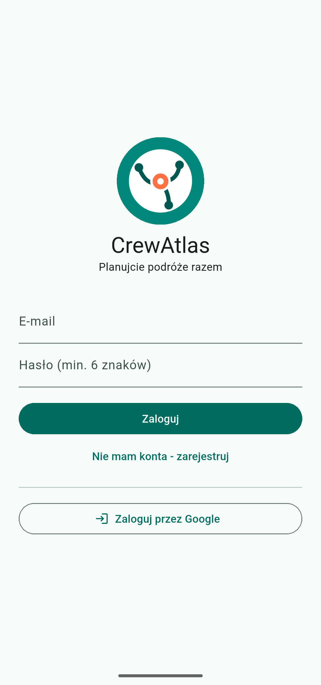
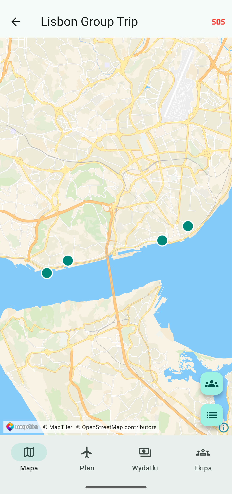
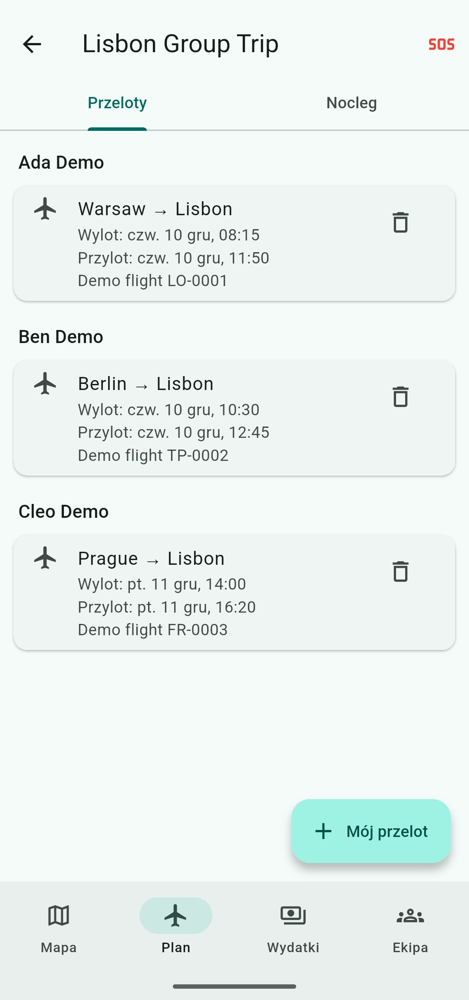
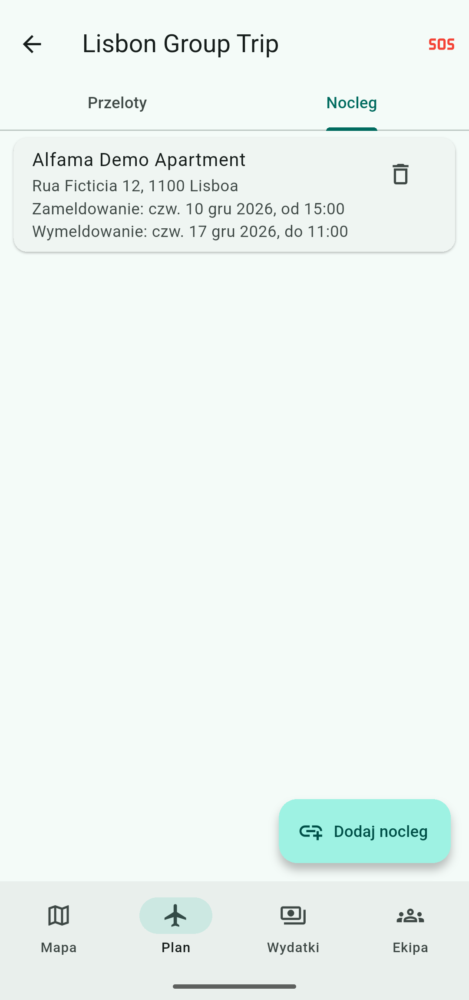
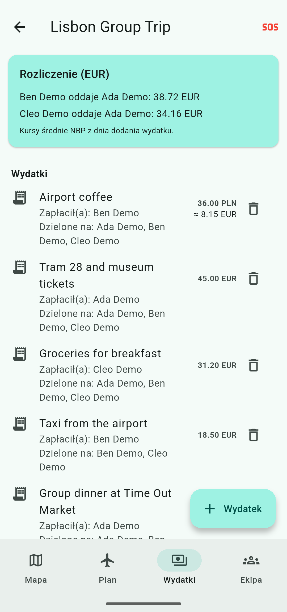
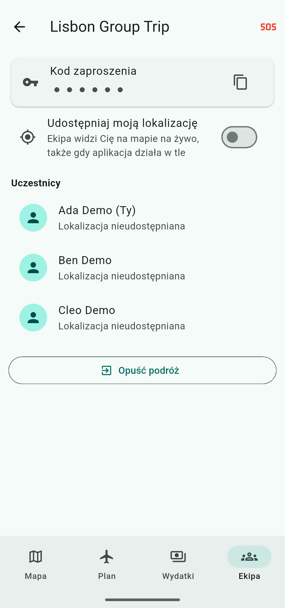
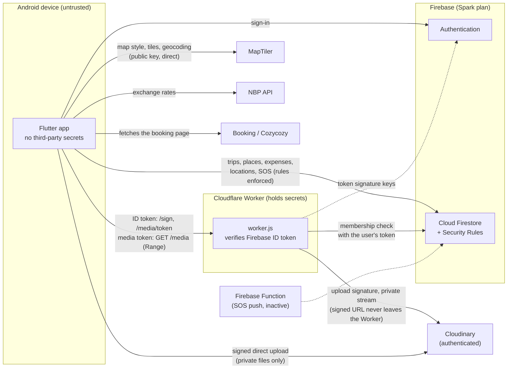

<p align="center">
  
</p>

# CrewAtlas

**Your crew. One shared world.**

CrewAtlas is an Android app for groups who travel together: a shared world map with photos, videos and voice notes, each person's own flights, stays imported from booking links, multi-currency expense splitting, and optional live location with an SOS alert.


> **Status: functional source-available prototype, version 0.5.1 (`pubspec.yaml`).** The features are implemented and covered by the tests listed below, but 0.5.1 itself has not yet been verified against real services (see the next note). The prototype is used by a small group of friends, not a production service and **not a safety system**. Source-available for study and noncommercial use, see [License](#license).
>
> **Verification status** (what was actually run, and where):
>
> | Area | Status |
> |---|---|
> | Flutter app on an **Android emulator**; Firebase sign-in, Firestore rules in use, trip screens and the MapTiler map | Checked with **test infrastructure**: a separate **test** Firebase project and a MapTiler key (see the screenshots below). |
> | Cloudflare Worker authorization | Checked **end to end, 40/40 checks**, with a test Worker (Free plan) and the test Firebase project: member token, outsider denial, forged and expired tokens, media-token expiry, no secrets in responses. Run **without** Cloudinary credentials, so Cloudinary endpoints returned a controlled error. |
> | Cloudinary `authenticated` delivery | Checked by a **separate standalone script** on the maintainer's Free account (authenticated upload, signed URLs, signed transformation; unsigned, public and wrongly signed URLs are denied). This does not involve the Worker or the app. |
> | Full media path (Flutter app, Worker, Cloudinary): upload, thumbnails, video seek, voice notes, deletion, access revoked after leaving a group | **NOT TESTED.** |
> | Isolation of a restricted Cloudinary API key from other assets in the same account | **NOT TESTED**, and not assumed. |
> | Authorization against a second real trip (cross-trip access) | **NOT TESTED** end to end. |
> | Production infrastructure | **Unchanged** by these tests. The maintainer's own installation has not been moved to this version. |
>
> The remaining automated tests (unit tests, the Firestore rules emulator suite, mocked integration tests) are not end-to-end evidence: the mocked scripts run the real Worker code against faked Firebase and Cloudinary.

This repository is an engineering portfolio project. The interesting parts are the security model (Firestore rules with an emulator test suite, a Cloudflare Worker that keeps third-party secrets off the device) and the design under free-tier limits.

## Screenshots

These are screenshots of the real app running on an **Android emulator**, with **fictional demo data** (a made-up "Lisbon Group Trip" with three demo users) against a **separate test Firebase project** and a MapTiler key. The invite code is masked. They show the screens that do not depend on uploaded media. Photos, thumbnails, video and voice notes are **not shown**, because the private-media path (Worker, Cloudinary) has **not yet been verified end to end**, see the verification note at the top.

| | |
|---|---|
|  |  |
| **Login.** E-mail and Google sign-in. | **Map.** Shared places on a MapTiler map, with the required logo and attribution links. |
|  |  |
| **Plan, flights.** One entry per traveller. | **Plan, accommodation.** Address, check-in and check-out. |
|  |  |
| **Expenses.** Shared costs, a PLN entry converted to EUR, and a "who owes whom" settlement. | **Crew.** Invite code (masked), live-location switch and members. |

The interface language is currently Polish.

## Key features

| Area | What it does | State |
|---|---|---|
| Shared map | Long-press to add a place. Attach photos, videos and voice notes with a short description. MapLibre vector map. | working |
| Flights | Every member enters their own legs (from, to, departure, arrival), so people can start from different cities. | working |
| Stays | Paste a Booking or Cozycozy link. Name, address, image, dates and check-in/out times are extracted on a best-effort basis and can be edited. | working, parser is heuristic |
| Expenses | Amount, currency, who paid, who participates. NBP exchange rates. "Who owes whom" in the trip currency, computed in minor units with a minimal number of transfers. | working, unit-tested |
| Live location | Optional, per trip, foreground service with a visible notification. | working, Android only |
| SOS | One tap raises a sound alarm on the other members' phones. | **only while the app process is alive**, see [Limitations](#limitations) |
| Auth and invites | E-mail or Google sign-in. Join a trip with a 6-character invite code. | working |

## Architecture



Trust boundaries:

- **The device is untrusted.** The app contains only the Worker URL and the public Firebase client configuration. Nothing in the app can sign a Cloudinary upload or call MapTiler with a secret key.
- **Firestore Security Rules are the authorization layer** for all trip data. The app talks to Firestore directly.
- **The Worker is the only holder of the Cloudinary API secret and of the media-token key.** They live in Cloudflare Secrets, never in the repository. Media are private: the phone never receives a Cloudinary URL ([docs/private-media.md](docs/private-media.md)). The MapTiler key, by contrast, is a public client key (see Limitations).

The dashed edges are not active: the SOS push function needs the paid Blaze plan and is not deployed.

## Engineering highlights

| Decision | Why |
|---|---|
| **Worker as a secrets broker** (`worker/worker.js`) | An APK can be unpacked, so no server secret may live in it. The Worker verifies the Firebase ID token itself (RS256 against Google's JWKS, `aud`, `iss`, `exp`) and only then uses its secrets. |
| **Private media behind a gateway** (`worker/worker.js`, [docs/private-media.md](docs/private-media.md)) | Files are stored as Cloudinary `authenticated` assets. The Worker issues a short HMAC token for one trip (after a Firestore membership check) and streams files with HTTP Range support, so a signed Cloudinary URL never reaches a phone. Responses are `private, no-store`. Leaving a trip stops new tokens, already issued tokens expire within minutes (10 by default). |
| **Upload signing bound to trip membership** | `/sign` asks Firestore, using the caller's own ID token, whether the caller can read the trip. The existing security rules make that decision, no service account key is needed. Signatures are per file (`public_id` chosen by the Worker, `overwrite=false`), always `type=authenticated`, restricted to a list of formats. Cloudinary does not enforce a per-request size limit, so size is limited only by the account and the client. |
| **Firestore rules with least privilege** (`firestore.rules`) | Profiles are readable only by their owner. Entries can be created only in the author's name, and deleted by their author or the trip owner. SOS and location timestamps are set by the server. A member cannot change `createdBy`, `inviteCode` or other members' names. |
| **Rules tested on the emulator** (`rules-test/`) | 33 scenarios, including a stranger, a member who left, impersonation, and the exact queries the app issues (Firestore rules do not filter query results). |
| **Settlement in minor units** (`lib/services/settlement.dart`) | Integer arithmetic, rate frozen at the time of the expense, minimal number of transfers. Covered by unit tests. |
| **Designed around free-tier limits** | Position updates are throttled (30 s interval, 50 m distance filter). The map and the people tab share one Firestore listener (`SharedStream`). Photos are re-encoded and videos compressed on the phone before upload. [limity.md](limity.md) (Polish) estimates which quota is hit first. |

## Technology stack

| Layer | Technology |
|---|---|
| App | Flutter (Dart), Android only |
| Map | MapLibre (`maplibre_gl`), MapTiler vector tiles (OpenStreetMap data) |
| Auth and data | Firebase Authentication, Cloud Firestore |
| Media | Cloudinary (`authenticated` delivery type) |
| Secrets broker | Cloudflare Worker (plain JavaScript, no dependencies) |
| Exchange rates | NBP public API |
| Tests | `flutter test`, Node test runner, Firebase Emulator Suite |

## Quick start

CrewAtlas needs **your own** Firebase project, Cloudflare Worker, Cloudinary account and MapTiler key. None of the maintainer's services or credentials are available or needed. Everything below has a free tier, none requires a payment card, and the full walkthrough is in [docs/setup.md](docs/setup.md).

```bash
git clone https://github.com/RG-automations/crew-atlas.git
cd crew-atlas
flutter pub get                      # Flutter 3.47.x (Dart ^3.13.5)

# 1. Firebase: download your google-services.json into android/app/
#    (template: android/app/google-services.json.example)
# 2. Deploy worker/worker.js and set its secrets (worker/README.md)
cp config.example.json config.local.json   # put your Worker URL and MapTiler key in it

flutter run --dart-define-from-file=config.local.json
```

Without `MAPTILER_KEY` the map shows a message instead of tiles. Without `WORKER_URL`, media uploads do not work.

## Configuration

| Setting | Where | Secret |
|---|---|---|
| `WORKER_URL`, `MAPTILER_KEY` | `--dart-define` (`config.local.json`, git-ignored) | the Worker URL is not secret. The MapTiler key ships inside the APK, so treat it as public and restrict it |
| `google-services.json` | `android/app/` (git-ignored) | client configuration, not a server secret |
| `CLOUDINARY_API_KEY`, `CLOUDINARY_API_SECRET`, `MEDIA_TOKEN_SECRET` | Cloudflare Worker secrets | **yes** |
| `CLOUDINARY_CLOUD`, `FIREBASE_PROJECT_ID` | Cloudflare Worker variables | no |
| `MEDIA_TOKEN_TTL` (optional, seconds, 60 to 3600, default 600) | Cloudflare Worker variable | no |

Hiding `google-services.json` does not protect your backend by itself. Protection comes from the security rules and from the Worker checks. See [docs/security-model.md](docs/security-model.md).

## Project structure

```text
lib/                 Flutter app (screens, services, models, widgets)
test/                Dart unit tests (settlement, booking parser, shared streams)
worker/              Cloudflare Worker + tests (node worker/test.mjs)
rules-test/          Firestore rules tests on the emulator
firestore.rules      Firestore Security Rules
functions/           Firebase Function for SOS push (inactive, needs Blaze plan)
docs/                Setup, security model, demo plan
android/             Android project (applicationId unchanged from earlier versions)
```

## Testing

```bash
flutter analyze && flutter test        # app
node worker/test.mjs                   # Worker signing (mocked Firestore REST and Firebase keys)
node worker/media.test.mjs             # private media gateway (mocked Firestore REST and Cloudinary)
node tools/migrate-media-to-private.test.mjs   # media migration and seeding tools (mocked)
node tools/e2e.test.mjs                        # backend check scripts, run against mocks (the real Worker code, faked Firebase and Cloudinary); not end-to-end
node worker/cloudinary-privacy-check.test.mjs   # safety tests of the manual Cloudinary check script (mocked)
cd rules-test && npm ci && npm test    # rules on the Firestore emulator (needs Java 21+)
```

The CI workflow ([.github/workflows/ci.yml](.github/workflows/ci.yml)) is configured to run the same checks plus gitleaks and actionlint. It has not run on GitHub yet.

Manual device checklist: [docs/android-test-checklist.md](docs/android-test-checklist.md) (Polish).

Not covered: there are no widget or integration tests, no Android build in CI, and nothing that exercises the Worker against real Cloudflare, Cloudinary or Firestore.

## Security

Secrets belong in Cloudflare Secrets (Worker) and GitHub Actions Secrets (CI). No secret is stored in the repository, and CI scans the whole history with gitleaks. See [SECURITY.md](SECURITY.md) for reporting and [docs/security-model.md](docs/security-model.md) for the model and known gaps.

## Limitations

- **Prototype, Android only.** No iOS, no production support, no SLA.
- **SOS is not an emergency system.** The alarm is delivered through a Firestore listener, so it only reaches phones whose app process is running. The code for push delivery when the app is closed exists (`functions/`) but is **inactive** because it needs the paid Blaze plan. Do not rely on it for safety.
- **Background location** depends on Android battery policies and a foreground-service notification. Location is stored until sharing is stopped, there is no automatic expiry.
- **Media privacy has limits.** New files are private to the trip's members and are read through the Worker. A member who leaves keeps access for at most the token lifetime (10 minutes by default), and nothing recalls files already downloaded. Files uploaded before this design are public by URL until they are migrated (a plan exists, it has not been run). Media streaming through the Worker uses the Free plan's request quota. New photos are stripped of EXIF (GPS, camera, serial numbers) before upload, older photos and all videos are not.
- **The MapTiler key is public.** The app calls MapTiler directly (MapTiler Cloud's terms do not allow a server-side proxy or cache without their approval), so the key is inside the APK and can be extracted. Abuse can only exhaust your Free quota, after which maps pause until the next month. Use a key restricted in the MapTiler dashboard and never commit it. MapTiler Free is for non-commercial use.
- **Free-tier quotas** (Firestore reads, Cloudinary credits, MapTiler requests) can be exhausted. [limity.md](limity.md) has estimates, not measurements.
- **Videos keep their metadata.** Photos are cleaned on the phone. A Cloudinary option for videos (`fl_force_strip`) exists behind `VIDEO_STRIP` but is unverified and off ([docs/private-media.md](docs/private-media.md)).
- **Open registration is a quota risk.** Anyone who has your Firebase configuration can create an account and consume free-tier quotas. The configuration is not published, and the Worker can restrict who gets media access (`ALLOWED_UIDS`), but Firestore usage cannot be rate-limited. Switching off self sign-up for a closed group is documented by Firebase, App Check does not fit sideloaded builds today ([docs/security-model.md](docs/security-model.md#open-registration-and-quota-abuse)).
- **You must run your own backend.** `STACK.md`, `USLUGI.md`, `limity.md` and `CHANGELOG.md` are the maintainer's working notes and are in Polish.

## Roadmap

Planned, not implemented:

- Run the migration of existing public media to private files (tool ready, not run).
- Decide on stripping metadata from videos (check script ready, not run).
- Full media end-to-end run on a test environment (Worker authorization is done, 40/40; Cloudinary isolation and the media path are open): [docs/phone-test-runbook.md](docs/phone-test-runbook.md), [docs/a2-test-worker.md](docs/a2-test-worker.md).
- Automatic expiry of stale live-location documents.
- Screenshots of photos, video and voice notes (after the end-to-end run above).

## License

CrewAtlas is **source-available**, not open source in the OSI sense. It is licensed under the [PolyForm Noncommercial License 1.0.0](LICENSE). You may use, study, modify and share it for any noncommercial purpose, which includes personal study, hobby projects and use by charitable, educational, public research, public safety or health, environmental and government organizations. **Commercial use needs a separate license from the copyright holder.** Contact via the author's GitHub profile.

The license covers this repository's own code. Third-party libraries and external services (Firebase, Cloudflare, Cloudinary, MapTiler, OpenStreetMap, NBP) are not covered, see [NOTICE](NOTICE). **The CrewAtlas name and logo are not part of the code license** and have their own terms in [docs/branding.md](docs/branding.md).

Required Notice: Copyright 2026 RG-automations (https://github.com/RG-automations)

## Author

[RG-automations](https://github.com/RG-automations)
