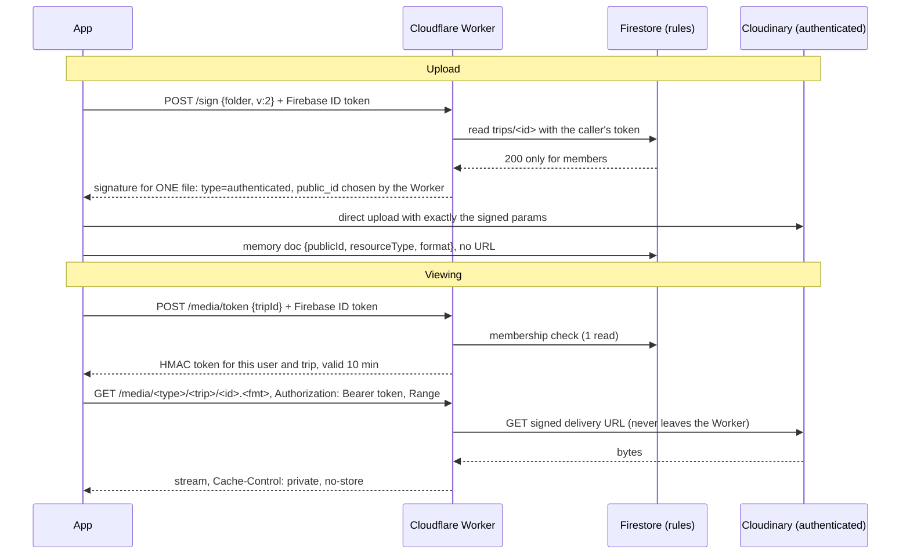

# Private media

Status: implemented in the repository, **not deployed** to the maintainer's production services, **not migrated**. Everything below about Cloudinary behaviour on a Free account rests on one manual check (`worker/cloudinary-privacy-check.mjs`, result PASS: `authenticated` upload, unsigned URL refused, public-type URL refused, signed URL works, tampered signature refused, signed transformation works) and on Cloudinary's public documentation (read 2026-11-17). Tests in this repository use mocks, they do not prove the integration with the real services.

## Goal

Photos, videos and voice notes of a trip are visible only to members of that trip, on free infrastructure, with no long-lived signed URL ever reaching a phone.

## Architecture



Rules, in short:

- **The phone never sees a Cloudinary URL.** The signed delivery URL is built and used inside the Worker. Redirects are not followed, so a redirect target cannot leak. The Worker does not log.
- **Authorization.** Membership is checked by Firestore itself, with the caller's own ID token, so `firestore.rules` is the single authority. No service account key.
- **File belongs to the trip.** The folder is `wycieczka/<tripId>/` (historical prefix, kept so existing data and installs keep working). The Worker chooses the `public_id` at signing time, the token is bound to one trip, and the Worker only builds paths under that trip's folder from strictly validated characters. Rules also require a new memory's `publicId` to match its own trip's folder.
- **Metadata from a trusted source.** The identifier of a file comes from the signature the Worker issued. For deletion the Worker reads the memory document from Firestore with the caller's token and re-checks the folder, author or trip owner. For viewing it deliberately does **not** read Firestore per request: a film is dozens of Range requests and Firestore reads are the first free-tier limit (50,000 per day). A client can ask for another allowed format of a file in its own trip (for example `.webp` instead of `.jpg`), which makes Cloudinary derive a variant. That costs a transformation, not access to anything outside the trip.
- **Clients cannot choose the delivery type.** `/sign` accepts only `v: 2`, ignores every other client field and always signs `type=authenticated`. The app refuses to store a memory unless Cloudinary's response confirms `type=authenticated` and the signed `public_id`. The old unsigned-type format is rejected with 426.
- **No bearer token in URLs.** Tokens travel only in the `Authorization` header, never in the query string. Thumbnails use one fixed transformation chosen by the Worker (`thumb=1`).
- **Secrets** (`CLOUDINARY_API_SECRET`, `MEDIA_TOKEN_SECRET`) live in Cloudflare Secrets.

Firestore stores only `publicId`, `resourceType`, `format`, never a URL. Old documents with `url` remain readable until they are migrated.

## Headers and caching

| Header | Value | Why |
|---|---|---|
| `Cache-Control` | `private, no-store` | No shared cache and no disk cache may keep a private file. Access is decided by a token that expires. |
| `Vary` | `Authorization` | A cache must not serve one user's response to another. |
| `Content-Type` | only `image/*`, `video/*`, `audio/*` from upstream, otherwise `application/octet-stream` | Cloudinary's response is not trusted to be a safe type. With `X-Content-Type-Options: nosniff`. |
| `Content-Range`, `Content-Length`, `Accept-Ranges` | passed through | Seeking in video. Only a single simple range is forwarded, anything else is ignored. |
| `Content-Disposition` | `inline` | Players, not downloads. |

Everything else from Cloudinary (ETag, cookies, custom headers, Location) is dropped. The body is streamed from Cloudinary to the client without buffering.

The Flutter app keeps decoded images in memory, keyed by a URL that contains no token, so reopening a gallery within a session does not request the files again.

## Removing access

| Situation | Effect |
|---|---|
| A member leaves the trip | Cannot get a new token (Firestore refuses the membership read). A token already issued keeps working until it expires: **default 10 minutes**, set `MEDIA_TOKEN_TTL` between 60 and 3600 seconds. This window is the cost of not hitting Firestore on every request. |
| Files already downloaded or screenshotted | Cannot be recalled. No design can. |
| Deleting a memory | The app calls `DELETE /media/memory/<trip>/<memory>`. The Worker lets the author or the trip creator delete the file in Cloudinary (`invalidate=true`), then the app deletes the document. Old public entries cannot be deleted this way. |
| Token or secret suspected leaked | Change `MEDIA_TOKEN_SECRET`: all tokens become invalid, apps fetch new ones. |

Access granularity is the **trip**: every member can read every file of the trip.

## Token lifetime: 600 s or 120 s

Default stays **600 s** in the code. 120 s is a supported setting (`MEDIA_TOKEN_TTL=120`) that I recommend only after two device tests (see below). Analysis for 5 people, 2 active hours per person per day:

| | 600 s | 120 s |
|---|---|---|
| Token requests per active user-hour (refresh margin is a quarter of the lifetime, 10 to 60 s) | about 7 (every 540 s) | about 40 (every 90 s) |
| Group per day | about 70 | about 400 |
| Firestore reads (1 per token) | 70 of 50,000 | 400 of 50,000 (0.8%) |
| Worker requests | +70 of 100,000 | +400 of 100,000 (0.4%), plus one Firebase token check each (CPU not measured) |
| Photos, thumbnails, voice notes | no difference: every file request takes a fresh-enough token, and a 401 triggers one retry with a new token | same |
| Video | the player's headers are fixed when it opens | **a stale token breaks later Range requests** |
| Access after leaving a trip | up to 10 minutes | up to 2 minutes |

Video is the only real cost. `video_player` cannot change headers while playing. The app now reopens the file with a new token, from the same position, when the user presses play and less than 15 s of the token is left (implemented, **not verified on a device**). What remains uncovered: a long video where the player itself reopens the connection in the middle of playback (after a network blip, or after pausing its buffer) more than 2 minutes after it opened. At 600 s the same failure exists after 10 minutes, so 120 s makes it 5 times likelier, not new. The first version of the refresh logic also had a bug that would have made 60 s tokens refresh on every file (a fixed 60 s margin); the margin now scales with the lifetime and is unit tested.

Recommendation: keep 600 s as the default. Run device tests 15 and 16 from [e2e-test-plan.md](e2e-test-plan.md) with `MEDIA_TOKEN_TTL=120` on the test Worker. If a 3-minute video survives a long pause and a short network drop, set 120 on production (the shorter exposure after leaving a trip is worth the extra few hundred requests). If it does not, stay at 600.

## Photo metadata (EXIF)

Checked in the source of `image_picker_android` 0.8.13+25: when the app asks for a smaller image (`imageQuality`, `maxWidth`), the plugin re-encodes the pixels and then **copies about 100 EXIF tags from the original, including 32 GPS fields, camera make, model and serial numbers, timestamps, maker notes and user comments**. So every photo uploaded so far carries whatever the original carried. The files already in Cloudinary are untouched and were not inspected.

New uploads are cleaned by `lib/services/image_metadata.dart` before they leave the phone:

- JPEG: all metadata segments are dropped (Exif, XMP, IPTC, comments, embedded thumbnail, JFXX, vendor segments, appended extra images such as HDR gain maps). Kept: what decoding needs, the ICC colour profile, and **only the Orientation tag** in a minimal Exif segment, so rotation stays correct.
- PNG: text chunks, `eXIf` and `tIME` are dropped.
- The compressed image data is copied byte for byte, so quality is unchanged and there is no re-encoding.
- Anything else (WebP, HEIC, a damaged file) is **refused**, nothing is uploaded.

Verified with synthetic fixtures (fake camera, serial, person and GPS) by unit tests and independently with ExifTool and Pillow: only `Orientation` remains, pixels are identical to the original. Not verified: real photos from a real camera, and whether the picker ever hands over a format other than JPEG or PNG.

**Video and audio.** Voice notes carry no location. Videos are re-encoded by `video_compress` on the phone, and whether that keeps the location atom of the source was not checked.

What Cloudinary documents about stripping (read 2026-11-17):

- `fl_force_strip` is listed for images **and videos**: "Instructs Cloudinary to clear all embedded metadata while applying an incoming transformation." The page does not name GPS, Exif or XMP individually and does not say how a video behaves.
- An **incoming** transformation (the `transformation` upload parameter) changes the stored original before it is saved, so no unstripped copy is ever kept. Videos are supported, nothing is said about asynchronous processing, size limits, plan restrictions or credit costs. An **eager** transformation only adds a derived copy and leaves the original as uploaded.
- By default Cloudinary strips most embedded metadata from *derived* (delivered, transformed) versions. The original keeps everything.
- Not documented, so **not assumed**: that `fl_force_strip` removes the GPS atom from an MP4, that it works on a Free account for videos, and that the result still plays.

Candidate configuration, kept private (`type=authenticated` stays):

| Option | How | Trade-off |
|---|---|---|
| **A. Incoming `fl_force_strip` on video uploads** | The Worker adds `transformation=fl_force_strip` to the signed upload parameters when `VIDEO_STRIP=1` and the request says `kind: video`. The client cannot change it. | The stored original is the stripped one. Re-encoding cost and time on Cloudinary's side are unknown. Audio is excluded. **Recommended if the check below passes and a phone can play the result.** |
| B. Deliver with `fl_force_strip` | Worker requests the signed derived version. | The original with GPS stays in Cloudinary (never served, but stored). On-the-fly video transformations are processed first, so the first request can wait, and Range behaviour is unverified. |
| C. Strip on the phone | Parse the MP4 and remove the location atom. | Rejected: if `moov` comes before `mdat`, removing bytes shifts the chunk offsets and corrupts the file. Not worth the risk. |

`VIDEO_STRIP` is **off by default** and implemented only as the option for A. Verify first with `worker/cloudinary-video-strip-check.mjs` on your account. It uploads three synthetic copies of `worker/fixtures/synthetic-gps.mp4` (a 1-second clip with a fake location in the open sea, fake author and comment, not a real recording) as `authenticated` assets, tests incoming and derived stripping, checks the result is still an MP4 and deletes exactly its own assets:

```bash
read -rs CLOUDINARY_API_SECRET && export CLOUDINARY_API_SECRET
read -r  CLOUDINARY_CLOUD   && export CLOUDINARY_CLOUD
read -rs CLOUDINARY_API_KEY && export CLOUDINARY_API_KEY
node worker/cloudinary-video-strip-check.mjs
```

It prints per variant `PASS` (metadata gone, still an MP4), `FAIL` (metadata still present or the file is broken) or `ERROR`, and a `RESULT` line. Status: **NOT RUN on a real account** (the script was tested only against mocks, which prove its logic, not Cloudinary's behaviour). A pass does not prove playback: the stripped clip must also play on a phone (checklist item 5.18). If it fails, keep videos as they are, say so in the README, and consider asking friends to switch off location in the camera app.

## Open registration and abuse

See [security-model.md](security-model.md#open-registration-and-quota-abuse). The Worker supports an optional allowlist (`ALLOWED_UIDS`, comma-separated Firebase uids): if set, only those accounts get upload signatures, media tokens or deletions. It is off by default.

## Why not `private_download_url`

Cloudinary documents `private_download_url` as a time-limited signed URL (default one hour, adjustable). It was compared and not chosen:

| | `private_download_url` | Worker gateway (chosen) |
|---|---|---|
| What the phone holds | A bearer URL, usable by anyone until it expires | Only a short token that works with this Worker, for one trip |
| Revocation | Only by expiry (an hour by default) | Within the token lifetime (10 minutes by default, minimum 1) |
| Thumbnails | Not verified | Verified on the account to work with a signed transformation |
| Seeking in video (Range) and inline playback | Not verified. It is a download endpoint, so `attachment` behaviour is possible. | Implemented and tested (mocked) |
| Worker requests | Still one per URL (the Worker signs it), only the bytes bypass it | Every file request passes through it |
| Free plan availability | Not verified | Verified for the pieces the Worker uses (`authenticated`, signed delivery URLs) |

Because the main requirement is that no usable URL reaches the phone and revocation is quick, the Worker is the gateway. The comparison is not a measurement: `private_download_url` was not tested on a real account.

## Limits and cost for a small group

Assumptions, not measurements: 5 people, an active day, each person opens the map 3 times (up to 30 thumbnails each, then kept in memory), looks at 30 photos, plays 3 videos (about 20 MB each, about 15 Range requests each), 5 voice notes, and requests about 24 tokens.

| Resource | Estimate | Free limit | Verdict |
|---|---|---|---|
| Worker requests | about 200 per person per day, about 1,000 for the group. A heavy day (10x) about 10,000. | 100,000 per day | fits, about 1% to 10% |
| Firestore reads (tokens, deletes) | about 120 per day | 50,000 per day | negligible. The per-request alternative would have added a read per file and per Range request. |
| Cloudinary bandwidth | about 350 MB per day, dominated by video (about 300 MB) | monthly credit pool (1 credit is about 1 GB of bandwidth, 25 credits on Free, figures from memory and the earlier `limity.md`, not re-verified) | a week-long trip is about 2.5 credits. Videos decide: 10 more plays of 20 MB a day add 0.2 GB per day. |
| Cloudinary storage | 100 photos at 0.3 MB plus 20 videos at 20 MB, about 0.4 GB | same pool | fits |
| Cloudinary transformations (thumbnails) | one derived thumbnail per file, in the hundreds | same pool, 1,000 transformations about 1 credit | fits |
| Worker CPU | token check and stream pass-through | 10 ms CPU per request on Free (waiting for I/O is not CPU) | expected to fit, **not measured** |

Compared with public URLs there is no Cloudflare edge cache: every view is fetched from Cloudinary again. Public URLs used Cloudinary's CDN, but bandwidth was counted there as well, so the quota effect is similar. If video plays dominate, the 25-credit pool is the first limit to hit, as before.

No paid service and no card are needed. Without `MEDIA_TOKEN_SECRET` the Worker answers 500 on media routes instead of serving anything.

## Migrating existing public files (tool ready, **not run**)

Existing memories point to public Cloudinary URLs (`type=upload`). They stay public until migrated. The tool is `tools/migrate-media-to-private.mjs`. It was tested only against mocks (`tools/migrate-media-to-private.test.mjs`). Run it first on a few test files of a test project, never straight on production.

Where the files live, on purpose: `--backup-dir` is **required** and has no default. The tool refuses a directory inside a Git repository, inside this project (it looks for `pubspec.yaml` and `firebase.json`), or in a synchronised folder (Syncthing's `.stfolder` marker, Dropbox, OneDrive, Google Drive, iCloud, Nextcloud). This project folder is itself synchronised with Syncthing on the maintainer's machine, so the old default of a folder next to the code would have copied private photos to other devices. Backup and state files are created with mode 600 (directories 700). `--allow-unsafe-location` exists and is a conscious override.

Preconditions: every phone runs the new app, the new Worker and rules are deployed and verified, `cloudinary-privacy-check.mjs` passes, and you have the owner's access token: `export GCLOUD_ACCESS_TOKEN=$(gcloud auth print-access-token)` (works with owner permissions and bypasses rules, so no service account key file is needed). Credentials come from the environment only. The output has only entry ids and statuses.

| Step | Command | What it does | Reversible |
|---|---|---|---|
| 0 | `plan --backup-dir <dir>` | Dry run: lists the entries that would migrate and the ones skipped (already private, no file, folder of another trip, another Cloudinary account). Writes nothing. | n/a |
| 1 | `plan --apply` | Saves the state file (`migration-state.json`, git-ignored). | yes |
| 2 | `backup --apply` | Downloads every original to `migration-backup/`, records SHA-256 and size, saves each Firestore document as JSON. | yes |
| 3 | `copy --apply` | Asks Cloudinary to fetch each public file as `type=authenticated` with the same `public_id` and `overwrite=false`. The public original stays. Needs the backup first. | `rollback` |
| 4 | `link --apply` | Adds `publicId`, `resourceType`, `format` to the document. `url` stays (older apps). | `rollback` |
| 5 | `verify --apply` | For each entry: the unsigned authenticated URL is refused, the signed one returns the same bytes as the backup, the document has the fields. Anything else is FAIL. | n/a |
| 6 | `finalize --apply --yes-delete-public` | Refuses unless **every** entry passed verify. Deletes the public originals (`invalidate=true`), removes `url`, checks the public URL is gone. | `restore` |

Every command needs the same `--backup-dir`. Every mutating command is a dry run without `--apply`: it prints `[dry-run] ...` and sends no mutating request. State is saved after each entry, so after a crash or a network error you run the same command again and it skips what is done. A copy that reached Cloudinary just before a crash is recognised ("already exists") and counted as done.

Rollback and restore:

- `rollback --apply` (before step 6): deletes the private copies and removes the added fields. The public files were never touched, so this is complete.
- After step 6, `rollback` refuses. `restore --apply` re-uploads the public originals from the local backup (checking the SHA-256 first) and writes `url` back.
- Keep `migration-backup/` until you are sure. It holds your group's private photos, so keep it off any synced or shared folder.

Final switch-off of the public originals is step 6 only. Do it after a confirmation period (for example a week) and only when nobody uses an old app, because old apps lose their images at that moment. Links that were shared earlier stop working, a copy somebody downloaded does not.

Safety properties (all covered by the mock tests, none yet by a real account):

| Property | How |
|---|---|
| Originals are never overwritten | Copy uses `overwrite=false` and a different delivery type. Public originals are touched only by `finalize`. |
| Backup is complete before anything depends on it | After writing, the file is read back and its SHA-256 compared. `copy` re-checks the backup file before copying. `finalize` refuses unless **every** backup file still exists and matches, because `restore` depends on it. |
| Integrity | `verify` compares the bytes of the private copy with the backup hash. Mismatch blocks `finalize`. |
| Idempotent and resumable | State saved after every entry. Re-running skips finished work. A copy that reached Cloudinary just before a crash is recognised. |
| No data loss on failure | `finalize` deletes the public file first, then removes `url`. If the second step fails the document still has `publicId`, the app prefers it, and a re-run completes the job. A memory deleted by a user mid-migration is detected: the private copy is cleaned up and the public file is not touched. |
| Rollback is real | Before `finalize`, `rollback` removes the private copies and the added fields. After it, `restore` re-uploads from the backup after checking the hash. |
| Minimal permissions | It cannot be narrower on the Cloudinary side: the free plan has one API key with full rights (no scoped keys that I know of). On the Firebase side it uses a short-lived access token (about one hour). A narrower option is a dedicated service account with only the *Cloud Datastore User* role, impersonated with `gcloud auth print-access-token --impersonate-service-account=...` (no key file). Creating it is a change in your Google Cloud project and needs your separate approval. |

### Rehearsal with synthetic files (not run)

`tools/seed-synthetic-legacy-media.mjs` creates a few synthetic images (generated patterns, no real photos) as **public** Cloudinary files plus matching memory documents in the old shape, so the migration can be practised end to end on a **test** project:

1. In the test app create a trip and note its id (`TESTTRIP` below). Creating test resources in external accounts needs your approval.
2. `node tools/seed-synthetic-legacy-media.mjs seed --trip TESTTRIP --backup-dir ~/crewatlas-rehearsal` (dry run). Add `--apply --i-am-using-a-test-project` to create 3 entries.
3. Run `plan`, `backup`, `copy`, `link`, `verify` (each with `--backup-dir ~/crewatlas-rehearsal`, then with `--apply`). Open the gallery in the app: the entries now come through the Worker.
4. `finalize --apply --yes-delete-public`, check again. Try `restore --apply` once to prove the way back.
5. `seed-synthetic-legacy-media.mjs cleanup --backup-dir ~/crewatlas-rehearsal --apply` deletes exactly what the seeding created (documents and both file types), nothing else.

Limits of the verification: it proves that the file in Cloudinary equals the backup and that anonymous access is refused. It does not prove that every phone shows the file, so also open the galleries and the map after step 5.

## Deployment plan (nothing here has been done)

Always test first on a separate free Firebase project and a second Worker (see [android-test-checklist.md](android-test-checklist.md)). On production:

1. Build and install the new app on every phone (it reads old public memories and new private ones).
2. Create the Cloudflare secret `MEDIA_TOKEN_SECRET` (a long random value), then deploy `worker/worker.js`. From now on the old unsigned upload format is refused (426) and old apps cannot upload.
3. Publish `firestore.rules`. From now on new memories must be private files of their own trip.
4. Run `cloudinary-privacy-check.mjs` and the device checklist.
5. Migration, if and when decided (previous section).

Rolling back steps 2 and 3 means redeploying the previous Worker and rules from your own backup of them. Memories created in the meantime keep working only with the new app.

## Tests

| File | Covers |
|---|---|
| `tools/migrate-media-to-private.test.mjs` | the migration tool (mocks): dry run changes nothing, full pipeline, resume after a failure without duplicates, corrupted copy blocks finalize, finalize needs verification and the explicit flag, rollback before and restore after, foreign and already private entries untouched |
| `worker/cloudinary-video-strip-check.test.mjs` | the video strip check script (mocks): marks present in control, stripped by incoming or derived, a broken result is a FAIL, polling of a derived version still being generated, cleanup of exactly its own ids, no leaks |
| `tools/e2e.test.mjs` | the backend end-to-end script and the preflight (mocks around the real Worker code): the whole scenario, leaving a trip, wrongly open rules or a Worker that admits a stranger are detected, cleanup after errors, production guard, no leaks |
| `test/image_metadata_test.dart` | EXIF stripping: GPS, make, model, serial, author, XMP, IPTC, comments, thumbnail and appended images removed, orientation kept, pixels byte-identical, PNG text chunks, unsupported and truncated files refused |
| `test/media_token_test.dart` | token refresh margin for 60, 120, 600 and 3600 s, one retry on 401, per-trip tokens |
| `worker/media.test.mjs` | token issue (member, stranger, other trip, bad or expired token, Firestore down), file reads, token bound to a trip, token only in the header, identifier substitution and path tricks, fixed thumbnail transformation, Range (valid and invalid), HEAD, streaming without buffering, redirects and wrong content types from upstream, leaving the group and token expiry, no leak of the signed URL or secrets in responses or logs, deletion permissions |
| `worker/test.mjs` | `/sign`: membership, formats, `type=authenticated` always, client cannot override, legacy format refused |
| `rules-test/rules.test.mjs` | memories only as private files of their own trip, plus all earlier rules scenarios |
| `test/media_test.dart` | client refuses entries pointing at another trip, old public entries keep working |

I also verified the worker tests detect mistakes: 17 deliberate bugs (token not bound to a trip, public cache header, token accepted in the URL, redirects followed, any Range forwarded, no expiry check, delete without ownership or folder check, `type` dropped from the signature, client-chosen transformation, buffering the whole body, any content type passed on, missing membership checks) were each caught by a failing test.

Not covered: the real Cloudflare runtime (CPU limits, streaming behaviour), real Cloudinary responses (the `authenticated` delivery was only checked with the manual script above), ExoPlayer and `audioplayers` behaviour on a real phone, and quotas under real use.
